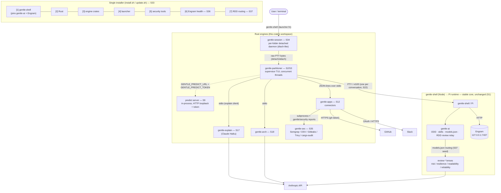

# gentle-partitioner — Architecture

How the engines we built fit together and plug into the existing Gentle stack
(gentle-shell, Pi, gentle-ai, Engram). The existing gentle-shell structure is a
stable core and is **never modified** (S1); every engine here is additive and
runs as its own process, so the user never perceives a stall (S2).

## Big picture



### ASCII (compact)

```
User ─► gentle-session (per-folder persistence, reattach)
          └► gentle-partitioner (supervisor TUI, Rust)
               ├─ PTY ─────────► gentle-shell (Node/Pi) ─► gentle-ai ─► review-* (models.json ← S37)
               │                                      └─► Engram (HTTP :7437)
               ├─ JSON-lines ──► gentle-apps ─► GitHub / Slack / Ciberseguridad
               │                    └─ subprocess ─► gentle-sec (Semgrep/OSV/Gitleaks/Trivy)
               ├─ stdio ───────► gentle-explain (Haiku) / gentle-arch
               └─ HTTP+token ─► predict server (n-gram, in-process)
```

## Engines

| Engine | Lang | Spawned by | Role | Spec |
| --- | --- | --- | --- | --- |
| `gentle-session` | Rust | launcher | Detached setsid server + PTY per folder; the partitioner and children survive terminal close and reattach. Raw-byte passthrough keeps CSI-u / kitty keys working. | S34 |
| `gentle-partitioner` | Rust | `gentle-session` (or directly) | Supervisor TUI: sidebar, editor, diff, chat, overlays; PTY I/O, input and render on separate threads; redraw only on change. | S2, S3, S11 |
| `gentle-shell` (child) | Node/Pi | `gentle-partitioner` | The existing stable core, one child per conversation (S22). Never modified. | S1, S6 |
| predict server | Rust | in-process in partitioner | n-gram suggestions over HTTP loopback with a bearer token; `GENTLE_PREDICT_URL`/`TOKEN` are passed to the gentle-shell child. | S9 |
| `gentle-apps` | Rust | `gentle-partitioner` | Connector host (JSON-lines over stdio): Slack, GitHub, Ciberseguridad. Off-UI-thread network. | S12, S13, S15 |
| `gentle-explain` | Rust | `gentle-partitioner` | Real-time code explainer + command helper (Claude Haiku). | S17, S25 |
| `gentle-arch` | Rust | `gentle-partitioner` | Architecture / deployment evaluation (Claude). | S18 |
| `gentle-sec` | Rust | `gentle-apps` (connector) | Runs installed Semgrep/OSV-Scanner/cargo-audit/Gitleaks/Trivy without a shell; normalizes findings (severity, CWE, OWASP), SARIF, secrets redacted; writes `.gentle/security`. | S35 |
| translator | Pi ext | gentle-shell | Optional: routes replies through English via LibreTranslate; fail-open. | S8 |

## Communication channels

| Between | Channel | Verified by |
| --- | --- | --- |
| session ↔ partitioner | raw PTY bytes (detach/attach, SIGWINCH redraw) | `session` lib + `e2e` + `launcher` |
| partitioner ↔ gentle-shell | PTY / vt100, one per conversation | `partitioner` lib |
| partitioner ↔ gentle-apps | JSON-lines over stdio | `apps` + `github_flow` + `slack_flow` |
| partitioner → predict server | HTTP loopback + constant-time bearer token, 64 KiB body cap | `predict_server` |
| gentle-apps → gentle-sec | subprocess (timeouts, capped output) + `.gentle/security` | `engines` |
| gentle-shell → gentle-ai / Engram | Pi runtime / HTTP `127.0.0.1:7437` | live `/health` 200 |
| gentle-ai → review-* lenses | model routing read from `<config>/gentle-ai/models.json` | S37 (routing gate cleared) |

The full workspace suite (`cargo test --workspace`) covers these protocols:
**527 passed, 0 failed**.

## Gentle stack integration

- **gentle-shell** is launched as a child and left untouched (S1). It pins and
  installs **gentle-ai** and **Engram** itself.
- **gentle-ai** owns ODD, skills, model routing (`models.json`) and the RDD
  native-review relay. The four review lenses
  (`review-risk/resilience/readability/reliability`) are routed through the
  global `models.json`.
- **Engram** is the shared memory server on `127.0.0.1:7437`.

### Two reliability guards the installer adds

| Guard | Problem it removes | Where |
| --- | --- | --- |
| Engram self-healing (S36) | A stale lower-version Engram server squatting port 7437 blocks the newer core every launch; Shell never stops a listening server. The installer detects a strictly-older server and, backup-first, stops it and starts the bundled daemon. | `scripts/lib/engram.sh`, `install.sh` step 6 |
| RDD review routing seed (S37) | The four review lenses are fail-closed; absent from `models.json` the native review refuses to launch, and that file is only written by an interactive apply. The installer idempotently seeds the four keys (`sonnet` + `medium`), never overwriting user entries. | `scripts/seed-review-models.mjs`, `install.sh` step 7 |

## Single installer (fresh machine)

`partitioner/scripts/install.sh` brings up the whole stack in user space (no
sudo), in seven idempotent steps: gentle-shell (→ gentle-ai + Engram), Rust,
the four engine crates, the launcher, the pinned security tools, the Engram
health check, and the RDD routing seed. `update.sh` fast-forwards a clean
checkout and rebuilds only what changed.

**Only prerequisite on a bare machine:** Node (`pi` / `npm` / `pnpm`) for step
1 — the Rust toolchain and everything else are installed by the script. Without
Node, step 1 stops with guidance.

```sh
partitioner/scripts/install.sh            # install/refresh the whole stack
partitioner/scripts/install.sh --dry-run  # print the plan, run nothing
partitioner/scripts/install.sh --update   # fast-forward + rebuild what changed
```
